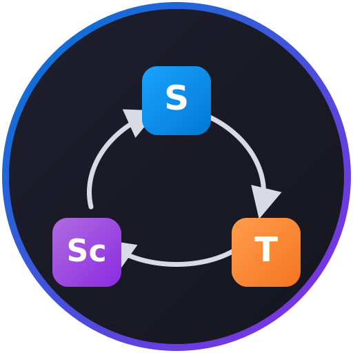

# DI-Loops

<p align="center">
  
</p>

**DI-Loops** is a VS Code extension for .NET developers. It scans dependency injection registrations, builds a constructor-derived dependency graph, and surfaces lifetime mismatches, unregistered dependencies, and duplicate registrations — directly in your editor.

Published by **[AryaCode Labs](https://github.com/aryacodelabs)**.

---

## Why DI-Loops?

ASP.NET Core apps register dozens of services across `Program.cs`, extension methods, and test projects. Lifetime mistakes (singleton capturing scoped services, trapped transients, duplicate bindings) are easy to miss until runtime.

DI-Loops gives you:

- A live **registration index** in the sidebar
- **Problems panel** diagnostics with click-to-source navigation
- **CodeLens** summaries on `AddSingleton` / `AddScoped` lines
- An interactive **dependency graph** webview

Works with regex heuristics out of the box, with optional **Roslyn** semantic analysis for cross-project accuracy.

---

## Features

| Feature | Description |
|---------|-------------|
| **DI Registrations tree** | Services grouped by **Singleton**, **Scoped**, **Transient**, and **Keyed** with pass/warning/error icons |
| **Problems panel** | `CAPTURED_SCOPED`, `TRAPPED_TRANSIENT`, `UNREGISTERED`, `DUPLICATE`, and low-confidence variants |
| **CodeLens** | Dependency counts and issue summaries above registration lines in `.cs` files |
| **Dependency graph** | Interactive vis-network webview — lifetime-colored nodes, mismatch edges (`captured!`, `trapped`) |
| **Incremental scan** | Re-scans changed C# files on save (debounced) |
| **Extension methods** | Follows `AddApplicationServices()`-style calls into other files under scan scope |
| **Comment-aware regex** | Ignores registrations inside `//` and `/* */` comments |
| **Roslyn host (v2)** | Optional semantic scanner with regex fallback |
| **Keyed services (v2.5)** | `AddKeyed*` / `TryAddKeyed*` parsing with separate registry dimension |

### Detected registration patterns

- `AddSingleton<T>()`, `AddScoped<T, TImpl>()`, `TryAddTransient<...>()`
- Lambda factories: `AddSingleton<T>(sp => new T())`
- Instance arguments: `AddSingleton<IConfiguration>(configuration)`
- `services.Replace(ServiceDescriptor.Scoped<...>())` (configurable)
- Keyed: `AddKeyedSingleton<T, TImpl>("key")` when `enableKeyed` is on

### Issue rules

| Issue | Severity | Rule |
|-------|----------|------|
| Captured scoped | Error | Singleton directly depends on a scoped service |
| Trapped transient | Warning | Singleton directly depends on a transient service |
| Unregistered | Error | Constructor dependency not found in registry |
| Duplicate | Warning | Same service type registered more than once (per key) |

---

## Installation

### VS Code Marketplace

1. Open **Extensions** (`Ctrl+Shift+X` / `Cmd+Shift+X`)
2. Search for **DI-Loops**
3. Click **Install**

Or install from the command line:

```bash
code --install-extension AryaCodeLabs.di-container-mapper
```

> The extension ID uses the internal package name `di-container-mapper`; the display name in the UI is **DI-Loops**.

### From source

```bash
git clone https://github.com/aryacodelabs/di-loops.git
cd di-loops
npm install
npm run build:roslyn   # optional, for Roslyn mode
npm run build
npm run package        # produces .vsix
code --install-extension di-container-mapper-*.vsix
```

**Requirements:** VS Code `^1.85.0`, Node.js 20+, .NET 8 SDK (Roslyn host only).

---

## Quick start

1. Open a folder containing a `.csproj` or `.sln`
2. Run **DI-Loops: Map DI Container** from the Command Palette (`Ctrl+Shift+P`)
3. Open the **DI Registrations** view in the Explorer sidebar
4. Click a registration to jump to source, or right-click → **Show Dependency Graph**

The status bar shows registration count, issue summary, and scanner mode (`heuristic` or `roslyn`).

### Recommended settings (multi-project solution)

```json
{
  "diContainerMapper.projectPath": "src/MyApp",
  "diContainerMapper.excludeTestProjects": true,
  "diContainerMapper.scanOnSave": true
}
```

### Roslyn mode (higher accuracy)

```json
{
  "diContainerMapper.useRoslyn": true,
  "diContainerMapper.roslynHostPath": ""
}
```

Build the host once: `npm run build:roslyn`. If the host is missing or fails, DI-Loops falls back to regex automatically.

### Keyed services (.NET 8+)

```json
{
  "diContainerMapper.enableKeyed": true
}
```

Keyed registrations appear under the **Keyed** tree group and use registry keys like `ICache@primary`.

---

## Commands

| Command | Description |
|---------|-------------|
| `DI-Loops: Map DI Container` | Full workspace scan |
| `DI-Loops: Refresh DI Index` | Re-resolve scope and rescan |
| `DI-Loops: Show DI Dependencies` | Editor context menu — graph for class at caret |
| `DI-Loops: Show Dependency Graph` | Tree context menu — graph for selected registration |
| `DI-Loops: Go to Registration` | Navigate to registration source |

---

## Settings

| Setting | Default | Description |
|---------|---------|-------------|
| `diContainerMapper.projectPath` | `""` | Limit scanning to a specific project folder |
| `diContainerMapper.scanEntireSolution` | `false` | Scan all projects under a `.sln` |
| `diContainerMapper.scanOnSave` | `true` | Re-scan changed C# files on save |
| `diContainerMapper.enableWebview` | `true` | Enable the interactive dependency graph |
| `diContainerMapper.useRoslyn` | `false` | Use Roslyn semantic analysis |
| `diContainerMapper.roslynHostPath` | `""` | Override path to the RoslynHost binary |
| `diContainerMapper.includeServiceDescriptorReplace` | `true` | Detect `ServiceDescriptor.Replace` calls |
| `diContainerMapper.excludeTestProjects` | `true` | Skip `*Tests`, `*UnitTest`, etc. |
| `diContainerMapper.enableKeyed` | `false` | Parse `AddKeyed*` registrations |

Configure via **File → Preferences → Settings** and search for `DI-Loops` or `diContainerMapper`.

---

## Scope resolution

When `projectPath` is empty, DI-Loops picks scan scope automatically:

1. `projectPath` setting (if set)
2. **Startup project** under the first `.sln` (skips Demo/Test/Sample projects)
3. Whole solution folder (only when `scanEntireSolution` is `true`)
4. Shallowest `Program.cs` / `Startup.cs`
5. First `.csproj` folder

For large solutions, open the app project folder or set `projectPath` to avoid cross-project false duplicates.

---

## Development

```bash
npm install
npm run build:roslyn
npm run build
npm test
npm run lint
```

Press **F5** in VS Code to launch the Extension Development Host.

```bash
npm run package   # create .vsix for local install or marketplace upload
```

---

## Contributing

Issues and pull requests are welcome at [github.com/aryacodelabs/di-loops](https://github.com/aryacodelabs/di-loops).

See [CHANGELOG.md](CHANGELOG.md) for release history.

---

## License

MIT — see [LICENSE](LICENSE).