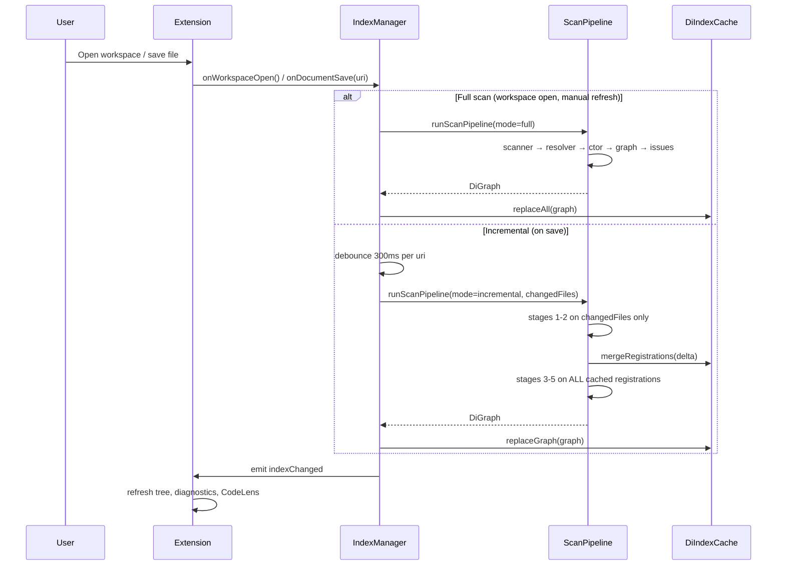
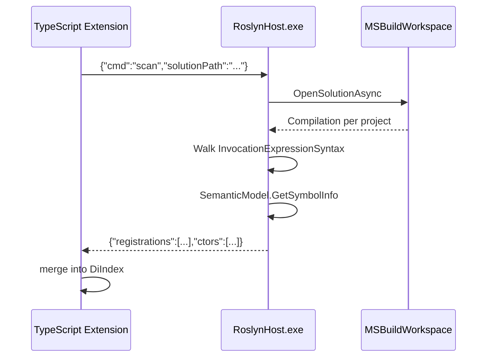
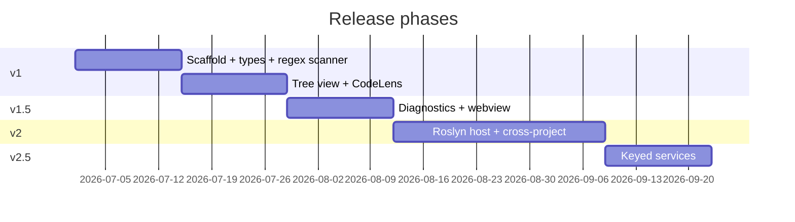

# DI Container Mapper — Design Document

| Field | Value |
|---|---|
| **Title** | DI Container Mapper VS Code Extension |
| **Author** | TBD |
| **Date** | 2026-06-24 |
| **Revised** | 2026-06-24 (review pass 2) |
| **Status** | Draft |
| **Requirements** | [`docs/di-container-mapper-requirements.md`](../docs/di-container-mapper-requirements.md) |

---

## Overview

The **DI Container Mapper** is a VS Code extension that statically analyzes .NET dependency-injection registrations (`AddSingleton`, `AddScoped`, `AddTransient`, `TryAdd`, factory lambdas, and later `AddKeyed`) across a workspace, builds a registration registry and constructor-derived dependency graph, and surfaces lifetime mismatches, unregistered dependencies, and duplicate registrations through native VS Code affordances (tree view, Problems panel, CodeLens) plus an interactive webview graph.

The extension ships in stages: **v1** uses regex/heuristics for single-project scanning to validate UX quickly; **v1.5** adds Problems panel and webview; **v2** introduces an out-of-process Roslyn host for semantic cross-project resolution; **v2.5** adds keyed-service support. The indexing layer is designed self-contained in this repo, with an explicit porting path from LinkLoops patterns when that code becomes available (LinkLoops is **not** present in this repository today).

---

## Background & Motivation

### Current state

- This repository (`di-loops`) is **greenfield**: only `docs/di-container-mapper-requirements.md` exists. No extension scaffold, no Roslyn host, no test fixtures yet.
- .NET teams commonly scatter DI setup across `Program.cs`, `Startup.cs`, and extension methods (`AddApplicationServices()`, `AddInfrastructure()`) in multiple projects.
- Developers currently answer registration questions by grep, running the app, or trial-and-error — often discovering **captured scoped dependencies in singletons** only in production under load.

### Pain points

| Pain point | Impact |
|---|---|
| Registrations spread across files/projects | "Is `IFoo` registered?" requires manual search |
| Extension-method indirection | Actual `AddXxx<>()` calls hidden in other assemblies |
| Lifetime bugs are latent | Singleton→Scoped fails at runtime or misbehaves silently |
| Duplicate interface registration | Last-wins semantics hide intent |
| No first-class VS Code tooling | Issues don't appear in Problems panel alongside compiler output |

### LinkLoops indexing note

Requirements reference reusing LinkLoops "scan workspace once, re-scan changed files on save" patterns. **LinkLoops source is not in this repo.** This design defines a self-contained `IndexManager` with the same behavioral contract so the extension can ship independently. When LinkLoops becomes available, we should evaluate extracting a shared `@di-loops/indexing` package or porting proven debounce/batching logic rather than re-inventing incremental update semantics.

---

## Goals & Non-Goals

### Goals

| ID | Goal | Target version |
|---|---|---|
| G1 | Build registry: `type → lifetime → location(s)` | v1 |
| G2 | Build dependency graph via constructor inspection | v1 |
| G3 | Detect captured dependency, trapped transient, unregistered dep, duplicate registration | v1 / v1.5 |
| G4 | Tree view grouped by lifetime with status icons | v1 |
| G5 | CodeLens on registration lines | v1 |
| G6 | Problems panel diagnostics | v1.5 |
| G7 | Interactive webview dependency graph | v1.5 |
| G8 | Cross-project semantic resolution via Roslyn | v2 |
| G9 | Factory-body `GetService`/`GetRequiredService` extraction | v2 |
| G10 | Keyed services as separate graph dimension | v2.5 |

### Non-Goals

- Runtime/IL analysis of the built DI container
- Auto-fix or code modification of mismatches
- Autofac, Ninject, or other non-Microsoft containers (v2.5+ candidate)
- Full MSBuild project-system integration beyond what Roslyn `MSBuildWorkspace` provides in v2

---

## Proposed Design

### High-level architecture

```mermaid
flowchart TB
    subgraph VSCodeHost["VS Code Extension Host (TypeScript)"]
        ACT[extension.ts / activate]
        CMD[Commands]
        IDX[IndexManager]
        PIPE[ScanPipeline]
        SCN[RegistrationScanner]
        EMR[ExtensionMethodResolver]
        CI[ConstructorInspector]
        GB[GraphBuilder]
        ID[IssueDetector]
        CACHE[DiIndexCache]
        TV[TreeViewProvider]
        WV[WebviewGraphPanel]
        DX[DiagnosticsProvider]
        CL[CodeLensProvider]
    end

    subgraph RoslynHost["Roslyn Analysis Host (.NET CLI) — v2"]
        RH[RoslynHost Program]
        MSW[MSBuildWorkspace]
        SEM[SemanticModel Walker]
    end

    ACT --> IDX
    CMD --> IDX
    IDX --> PIPE
    PIPE --> SCN --> EMR --> SCN
    SCN --> CI --> GB --> ID
    ID --> CACHE
    CACHE --> TV
    CACHE --> DX
    CACHE --> CL
    CACHE --> WV
    SCN -.->|stdio JSON v2| RH
    RH --> MSW --> SEM
    SEM -.->|RegistrationDto[]| PIPE
```

### Component responsibilities

| Component | Responsibility | v1 | v2 |
|---|---|:---:|:---:|
| `IndexManager` | Orchestrates full/incremental scans, debouncing, cache invalidation | ✓ | ✓ |
| `RegistrationScanner` | Finds `Add*` / `TryAdd*` call sites | regex | Roslyn delegate |
| `ExtensionMethodResolver` | Follows `services.AddXxx()` into method bodies | heuristic (same file) | Roslyn symbol resolution |
| `ConstructorInspector` | Extracts ctor parameter types per concrete impl | regex/heuristic | Roslyn |
| `GraphBuilder` | Registry + edges + transitive closure | ✓ | ✓ |
| `IssueDetector` | Applies rules from §Issue Detection | ✓ | ✓ |
| UI providers | Tree, webview, diagnostics, CodeLens | staged | ✓ |
| `ScanPipeline` | Single orchestration entry for scan → graph → issues | ✓ | ✓ |

### ScanPipeline orchestration

`IndexManager` does **not** call scanner or UI providers directly for graph assembly. All full and incremental scans flow through `ScanPipeline`, which owns stage ordering, error boundaries, and cache writes.

```typescript
// src/index/scanPipeline.ts

export interface ScanPipelineInput {
  mode: 'full' | 'incremental';
  scopeRoot: vscode.Uri;           // resolved project/solution folder
  changedFiles?: vscode.Uri[];     // incremental only
  scannerVersion: 'regex-v1' | 'roslyn-v2';
}

export interface ScanPipelineResult {
  graph: DiGraph;
  errors: ScanStageError[];        // non-fatal per-file/stage failures
}

/** Injectable stage implementations — enables unit tests with mocks (PR 2/6). */
export interface ScanPipelineDeps {
  scanner: IRegistrationScanner;
  extensionMethodResolver: IExtensionMethodResolver;
  constructorInspector: IConstructorInspector;
  buildGraph: (
    registrations: Registration[],
    edges: DependencyEdge[],
    scannerVersion: 'regex-v1' | 'roslyn-v2'
  ) => Omit<DiGraph, 'issues'>;
  detectIssues: (graph: DiGraph) => DiIssue[];
  roslynClient?: IRoslynHostClient;   // v2 only; omitted in v1 wiring
}

export async function runScanPipeline(
  input: ScanPipelineInput,
  deps: ScanPipelineDeps,
  signal?: AbortSignal
): Promise<ScanPipelineResult> {
  // See call order below — full vs incremental differ only in stage 1–2 scope
}
```

**Call order (contractual):**

| Stage | Full scan | Incremental scan |
|---|---|---|
| 1–2 | `scanner.scanWorkspace(scopeRoot)` → all registrations | `scanner.scanFile(changedFiles)` → registration **delta** only |
| 2b | — | `DiIndexCache.mergeRegistrations(changedFiles, delta)` — remove prior regs where `location.fileUri` ∈ changedFiles; retain all others |
| 3 | `constructorInspector.inspect(allRegistrations)` | **Same:** `inspect(allRegistrations)` on **full cached set** — not just changed files |
| 4 | `buildGraph(allRegistrations, allEdges, scannerVersion)` | **Same:** rebuild from full set |
| 5 | `detectIssues(graph)` | **Same:** recompute all issues |
| 6 | `DiIndexCache.replaceAll(graph)` | `DiIndexCache.replaceGraph(graph)` — atomic edges + issues replace |

**Why stage 3 runs on all registrations incrementally:** Registrations live in `Program.cs` / extension-method files, but constructor signatures live in separate implementation classes. Saving `OrderService.cs` (adding a ctor parameter) does not change any registration row in `Program.cs`, yet edges and issues for `OrderService` must update. Re-running `ConstructorInspector` on the full cached registration set after every incremental save is cheap in v1 (~50 classes, <50ms) and guarantees edge/issue correctness.

**Impacted-registration tracking (cache metadata):** `DiIndexCache` maintains `implFileToRegistrationIds: Map<fileUri, registrationId[]>` populated during stage 3 via `constructorInspector.locateImplFile(implType, scopeRoot)`. Used for logging/debugging which registrations were affected by an implementation-file edit; stage 3 still processes all registrations regardless.

**Error boundaries:** A failure in one file (parse error, missing type) records a `ScanStageError` and continues other files. `IssueDetector` always runs on the best-effort graph. UI providers read **only** from `DiIndexCache` on `indexChanged` — never re-run detection themselves.

**Incremental semantics:** `onDocumentSave` debounces 300ms, then:

1. Runs stages 1–2 on `changedFiles` only (registration delta)
2. Merges registration delta into cache
3. Runs stages 3–5 on the **entire** cached registration set (edges + issues rebuilt atomically)
4. Emits one `indexChanged`

It does **not** merge raw `Registration[]` without re-running constructor inspection and issue detection on the full set.

### Indexing strategy (self-contained)

Mirrors LinkLoops contract without external dependency:



**Performance budget (targets):**

| Scenario | Target | Notes |
|---|---|---|
| Initial scan, ~50 C# files, v1 regex | < 2 s | Single project, no Roslyn |
| Incremental re-scan on save | < 200 ms | One file, debounced; includes full-set ctor inspect (~50 classes) |
| v2 full solution (5 projects, ~500 files) | < 15 s cold | Roslyn host warmup dominates |
| v2 incremental | < 1 s | Re-parse changed compilation units |
| Webview render, 200 nodes | < 500 ms | vis-network, lazy layout |
| Memory (extension host) | < 100 MB | Index + graph in memory |

**File discovery:** `vscode.workspace.findFiles('**/*.{cs,csproj,sln}', '**/bin/**,**/obj/**,**/node_modules/**')`.

**v1 project scope resolution (deterministic):**

Precedence when resolving `scopeRoot` for scanning:

1. **`diContainerMapper.projectPath`** config (absolute or workspace-relative folder) — highest precedence
2. Directory containing the **first** `.sln` found (lexicographic path sort across all workspace roots)
3. Directory containing the **first host entry file** — `Program.cs` or `Startup.cs` — found via breadth-first search from each workspace root (shallowest path wins; ties broken lexicographically)
4. Directory containing the **first** `.csproj` (lexicographic sort)
5. If none found: show notification prompting user to set `projectPath`; index stays empty

**Multi-root workspaces:** Each root is searched independently in steps 2–4; the winning scope is the candidate with the shallowest relative depth, then lexicographic path. Only **one** scope is active in v1 (no multi-project parallel indexes). v2 adds a solution-picker command (OQ3).

**Blazor / WASM subfolders:** A `Program.cs` nested under `Client/` is found in step 3 if it is the shallowest host entry across roots; users can override with `projectPath`.

### Registration Scanner (v1 — regex)

Parses call sites using patterns from requirements §4. Output is `Registration` records with **syntactic** type names (may be unqualified).

```typescript
// src/scanner/regexRegistrationScanner.ts
export interface ScanContext {
  fileUri: vscode.Uri;
  text: string;
  projectRoot?: string;
}

export interface IRegistrationScanner {
  scanFile(ctx: ScanContext): Promise<Registration[]>;
  scanWorkspace(roots: vscode.Uri[]): Promise<Registration[]>;
}
```

**Patterns (compiled once):**

- `Add(Singleton|Scoped|Transient)<...>()`
- `TryAdd(Singleton|Scoped|Transient)<...>()`
- Factory: `AddXxx<T>(sp => new T(...))` — v1 records factory flag; body parsing deferred to v2
- Keyed: stub in v2.5

**Limitations accepted in v1:**

- No cross-project namespace resolution (`IFoo` in ProjectA vs `MyApp.IFoo` in ProjectB) — mitigated by v1 type-matching algorithm below
- Extension methods in other files: followed via `ExtensionMethodResolver` within `scopeRoot` only
- Multiple constructors: **most-parameters public instance constructor** (see Constructor Inspector — same rule everywhere)
- Factory registrations: `isFactory` recorded; implicit `GetService` deps deferred to v2 (see Risks)

### Registration Scanner (v2 — Roslyn host)

Out-of-process .NET 8 console app `tools/RoslynHost/` invoked via `child_process` with **newline-delimited JSON (NDJSON)** on stdio. Full protocol contract: [Appendix A: Roslyn Host Stdio Protocol](#appendix-a-roslyn-host-stdio-protocol).



**Why out-of-process:** Roslyn + MSBuild cannot run inside the VS Code Node extension host. Spawning a .NET tool matches patterns used by OmniSharp, C# Dev Kit analyzers, and keeps the extension package small (host downloaded on first use or bundled per platform — see Key Decisions).

**Roslyn host commands:** `ping`, `scan`, `shutdown` — see Appendix A for envelopes, correlation IDs, timeouts, and incremental `changedFiles` semantics.

### v1 type matching (registry lookup)

v1 `IssueDetector` must resolve constructor parameter types against the registration registry without Roslyn. Type equivalence uses a **tiered matching algorithm** with confidence scoring:

```typescript
// src/types/typeMatcher.ts

export type MatchConfidence = 'high' | 'medium' | 'low';

export interface RegistryLookupResult {
  registration?: Registration;
  confidence: MatchConfidence;
  matchKind: 'exact' | 'simpleName' | 'usingResolved' | 'suffix' | 'ambiguous' | 'none';
}

export function lookupInRegistry(
  paramType: string,
  registry: Map<string, Registration[]>,
  context: { fileUri: string; fileText: string; scopeRoot: string }
): RegistryLookupResult;
```

**Algorithm (evaluate steps in order; steps 2–3 interact for disambiguation):**

| Step | Rule | Confidence |
|---|---|---|
| 1 | **Exact string match** on `serviceType` or `implementationType` (case-sensitive) | high |
| 2 | **Simple name match** — collect **all** registry entries whose unqualified name equals `paramType` (do **not** stop on first hit) | see disambiguation |
| 3 | **`using` directive resolution** — parse `using` / `using Alias = ...` in the dependency context file (implementation class file); resolve to namespace + simple name; also used to disambiguate step 2 | medium |
| 4 | **Suffix match** — registry entry FQN ends with `.` + param simple name (e.g. param `IFoo` matches `MyApp.IFoo`); only if steps 2–3 produced no match | low |
| 5 | No match → `UNREGISTERED` candidate | none |

**Step 2 disambiguation (simple-name collisions):**

| Candidates after step 2 | Action |
|---|---|
| 0 | Proceed to step 3 |
| 1 | Match; `matchKind: 'simpleName'`, confidence **medium** |
| >1 | Attempt **using-based disambiguation**: prefer candidate whose namespace (or suffix) appears in a `using` directive of the implementation class file; if exactly one candidate matches → confidence **medium**, `matchKind: 'usingResolved'` |
| >1 after disambiguation | **No match selected** — do not pick arbitrary first candidate. Emit `UNREGISTERED_LOW_CONFIDENCE` Warning (`matchKind: 'ambiguous'`) to avoid false `CAPTURED_SCOPED` from wrong lifetime |

Unit test required: two registrations `NamespaceA.IFoo` and `NamespaceB.IFoo`, ctor param `IFoo` with `using NamespaceA` → resolves to `NamespaceA.IFoo`; without `using` → ambiguous warning.

**Severity gating by confidence:**

| Confidence / outcome | `DiIssue.code` | Severity |
|---|---|---|
| high / medium | `UNREGISTERED` | Error |
| low (suffix match) | `UNREGISTERED_LOW_CONFIDENCE` | Warning |
| ambiguous (step 2 collision unresolved) | `UNREGISTERED_LOW_CONFIDENCE` | Warning |
| none | `UNREGISTERED` | Error |

**Known v1 false-positive rate:** Expect ~5–15% `UNREGISTERED` noise on solutions using heavy type aliases, generic constraints, or cross-folder partial classes within the same project. Mitigations: v1 release notes disclaimer; status bar badge `DI (heuristic)`; fast path to v2 Roslyn. KD9 (single-project scope) reduces cross-project ambiguity.

### Extension Method Resolver

**v1:** If invocation is `services.AddApplicationServices()` (or `builder.Services.Add...`), search **only files under `scopeRoot`** (same glob as `RegistrationScanner`) for `void AddApplicationServices(this IServiceCollection` and recursively scan method body text. Does not search other workspace roots or folders outside `scopeRoot` (KD9).

**v2:** Resolve `IMethodSymbol`, get declaring syntax reference, scan that method's syntax tree with semantic model. Handle cross-project references via Roslyn symbol IDs.

**Cycle protection:** Maintain `visitedMethods: Set<string>` keyed by `filePath:methodName` (v1) or `symbolId` (v2), max depth 20.

### Constructor Inspector

For each registration's **implementation type** (`TImpl` or `T` when concrete-only):

1. Locate class declaration (regex: `class\s+TImpl` or `record\s+TImpl` in files under `scopeRoot`)
2. Select the **primary constructor**: the public instance constructor with the **most parameters**; ties broken by source order (first declared wins). Rationale: aligns with typical DI injection patterns and .NET `[PrimaryConstructor]` usage where the injected ctor has the most parameters.
3. Extract parameter types as syntactic strings
4. v2: `SemanticModel.GetDeclaredSymbol`, `IMethodSymbol.Parameters` — same selection rule on `IMethodSymbol` candidates

If `isFactory === true` (v1): skip ctor inspection; edge list is empty until v2 factory-body parsing. Tree/CodeLens show `factory (deps unknown in v1)`.

Edges: `DependencyEdge { from: registrationKey, to: dependencyType, fromLifetime, toLifetime }` — **direct edges only** (see Issue Detector).

### Graph Builder

```typescript
// src/graph/graphBuilder.ts
export function buildGraph(
  registrations: Registration[],
  edges: DependencyEdge[],
  scannerVersion: 'regex-v1' | 'roslyn-v2'
): Omit<DiGraph, 'issues'> {
  const registry = buildRegistryMap(registrations);
  const adjacency = buildAdjacency(edges);           // direct edges only
  const transitive = computeTransitiveClosure(adjacency); // UI expansion only — NOT used by IssueDetector
  return { registrations, edges, adjacency, transitive, indexedAt: Date.now(), scannerVersion };
}
```

`ScanPipeline` calls `detectIssues(graph)` after `buildGraph`, then assigns `graph.issues` before caching.

**Registration key:** `qualifiedTypeName` + optional `@key` suffix for keyed services (v2.5).

Duplicate detection: group by **interface/service type** (first generic arg or sole type arg), warn if >1 non-`TryAdd` registration for same key (TryAdd is intentionally idempotent).

### Issue Detector

Rules from requirements §6:

| Rule ID | Condition | Severity | VS Code DiagnosticSeverity |
|---|---|---|---|
| `CAPTURED_SCOPED` | Singleton → Scoped (direct ctor edge) | Error | Error |
| `TRAPPED_TRANSIENT` | Singleton → Transient | Warning | Warning |
| `UNREGISTERED` | Parameter type not in registry (high/medium confidence) | Error | Error |
| `UNREGISTERED_LOW_CONFIDENCE` | Parameter type unresolved or ambiguous (low confidence / suffix / collision) | Warning | Warning |
| `DUPLICATE` | Same service type registered >1 | Warning | Warning |

**No issue:** Scoped→Transient, Transient→*, etc.

```typescript
// src/issues/issueDetector.ts
export function detectIssues(graph: DiGraph): DiIssue[] {
  // Lifetime rules: DIRECT constructor/factory edges only (graph.edges, NOT graph.transitive)
  // Singleton → Scoped on transitive path (A→B→C) does NOT fire unless A→C is a direct edge
  // Diagnostics anchored at registration.sourceRange
}
```

**Direct-edge-only rule:** `CAPTURED_SCOPED`, `TRAPPED_TRANSIENT`, and `UNREGISTERED` evaluate **only** `DependencyEdge` entries in `graph.edges` (constructor + v2 factory-resolved). `graph.transitive` is used exclusively by tree "expand transitive" and webview ego-graph depth controls — never for issue severity.

Factory dependencies (v2): edges from `sp.GetRequiredService<T>()` inside factory lambda body are added to `graph.edges` as `resolution: 'factory'` and participate in the same direct-edge lifetime rules.

### UI layer

#### Tree View (`DiRegistrationsProvider`)

- View ID: `diContainerMapper.registrations`
- Group: `Singleton` | `Scoped` | `Transient` | `Keyed` (v2.5)
- Node label: `IFooService → FooService`
- Icon: codicon `pass` / `error` / `warning` from worst issue on node
- Children: direct dependencies (one level; expand loads from graph)

#### Webview Graph (`WebviewGraphPanel`)

- Library: **vis-network** (lighter integration than raw d3 for v1.5; see Alternatives)
- Nodes: color by lifetime (singleton=blue, scoped=green, transient=orange, issue=red border)
- Edges: red + label `captured!` / `trapped` on mismatch
- Message passing: `postMessage({ type: 'navigate', uri, range })` → extension validates payload (see Security) before `openTextDocument`
- CSP: nonce scripts, no external CDN; bundle vis-network in `media/`; all resource URIs via `webview.asWebviewUri`

#### Diagnostics Provider

- Collection name: `di-container-mapper`
- One diagnostic per `DiIssue`, `source: 'DI Container Mapper'`
- `vscode.Diagnostic.code` = `DiIssue.code` (string)

**`DiIssue` → `vscode.Diagnostic` mapping:**

| `DiIssue.kind` | `DiIssue.code` | `DiagnosticSeverity` | `message` pattern |
|---|---|---|---|
| `CAPTURED_SCOPED` | `CAPTURED_SCOPED` | Error | `Singleton '{impl}' captures scoped dependency '{dep}'` |
| `TRAPPED_TRANSIENT` | `TRAPPED_TRANSIENT` | Warning | `Singleton '{impl}' traps transient dependency '{dep}'` |
| `UNREGISTERED` | `UNREGISTERED` | Error | `Unregistered dependency '{dep}'` |
| `UNREGISTERED_LOW_CONFIDENCE` | `UNREGISTERED_LOW_CONFIDENCE` | Warning | `Possible unregistered dependency '{dep}' (low confidence)` or `(ambiguous type match)` |
| `DUPLICATE` | `DUPLICATE` | Warning | `Duplicate registration for '{serviceType}'` |

`matchConfidence` and `matchKind` are not surfaced in the Problems panel message in v1 but are logged to the output channel for debugging.

#### CodeLens Provider

- Document selector: `**/*.cs`
- Above registration line: `$(warning) captures scoped: IUserContext` or `3 dependencies`
- Resolved on `indexChanged` event

### Commands

| Command ID | Title | Behavior |
|---|---|---|
| `diContainerMapper.map` | Map DI Container | Full workspace scan, show tree |
| `diContainerMapper.showGraph` | Show Dependency Graph | Webview for selected registration |
| `diContainerMapper.refresh` | Refresh DI Index | Invalidate cache, full rescan |
| `diContainerMapper.showDependencies` | Show DI Dependencies | Context menu on class — show graph |

---

## API / Interface Changes

Greenfield — all interfaces are new. Public extension surface:

### TypeScript core types

```typescript
// src/types.ts

export type Lifetime = 'Singleton' | 'Scoped' | 'Transient';

export interface SourceLocation {
  fileUri: string;
  range: { startLine: number; startCol: number; endLine: number; endCol: number };
  lineText?: string;
}

export interface Registration {
  id: string;                    // logical key — see ID stability below
  serviceType: string;           // interface or self
  implementationType: string;
  lifetime: Lifetime;
  isTryAdd: boolean;
  isFactory: boolean;
  key?: string;                  // v2.5 keyed
  location: SourceLocation;
  projectPath?: string;
}

export interface DependencyEdge {
  fromRegistrationId: string;
  toType: string;
  resolution: 'constructor' | 'factory' | 'keyed';
  toRegistrationId?: string;     // if resolved in registry
}

export type IssueKind =
  | 'CAPTURED_SCOPED'
  | 'TRAPPED_TRANSIENT'
  | 'UNREGISTERED'
  | 'UNREGISTERED_LOW_CONFIDENCE'
  | 'DUPLICATE';

export type IssueSeverity = 'error' | 'warning';

export interface DiIssue {
  kind: IssueKind;
  code: string;                    // vscode.Diagnostic.code — mirrors kind or sub-variant
  severity: IssueSeverity;
  message: string;
  registrationId?: string;
  relatedType?: string;
  location: SourceLocation;
  matchConfidence?: MatchConfidence;  // populated for UNREGISTERED variants
  matchKind?: RegistryLookupResult['matchKind'] | 'ambiguous';
}

export interface DiGraph {
  registrations: Registration[];
  edges: DependencyEdge[];
  issues: DiIssue[];
  indexedAt: number;
  scannerVersion: 'regex-v1' | 'roslyn-v2';
}
```

**Registration ID stability:** IDs must survive line shifts on edit to avoid tree-selection loss and diagnostic flicker.

```typescript
// Logical key (stable across line edits):
// hash(scopeRoot + fileUri + serviceType + implementationType + lifetime + key?)
// Display anchor: SourceLocation.range updated on each scan from current syntax position
```

On incremental scan, match existing registrations by logical key first; update `location.range` in place. Tree view selection tracks logical key, not line number.

### Roslyn host JSON DTOs (v2)

```csharp
// tools/RoslynHost/Models/RegistrationDto.cs
public sealed record RegistrationDto(
    string ServiceTypeFqName,
    string ImplementationTypeFqName,
    string Lifetime,
    string FilePath,
    int StartLine,
    int StartColumn,
    bool IsTryAdd,
    bool IsFactory,
    string? Key);
```

### VS Code contribution points (`package.json`)

```json
{
  "name": "di-container-mapper",
  "displayName": "DI Container Mapper",
  "publisher": "aryacodelabs",
  "version": "0.1.0",
  "engines": { "vscode": "^1.85.0" },
  "activationEvents": [
    "onStartupFinished",
    "workspaceContains:**/*.csproj",
    "workspaceContains:**/*.sln",
    "onLanguage:csharp"
  ],
  "main": "./dist/extension.js",
  "contributes": {
    "views": {
      "explorer": [{ "id": "diContainerMapper.registrations", "name": "DI Registrations" }]
    },
    "commands": [ /* see Commands table */ ],
    "menus": {
      "editor/context": [
        {
          "command": "diContainerMapper.showDependencies",
          "when": "editorLangId == csharp",
          "group": "navigation@99"
        }
      ],
      "view/item/context": [
        {
          "command": "diContainerMapper.showGraph",
          "when": "view == diContainerMapper.registrations",
          "group": "inline"
        }
      ]
    },
    "configuration": {
      "title": "DI Container Mapper",
      "properties": {
        "diContainerMapper.scanOnSave": { "type": "boolean", "default": true },
        "diContainerMapper.projectPath": { "type": "string", "description": "v1: limit scan to project folder" },
        "diContainerMapper.roslynHostPath": { "type": "string", "description": "Override path to RoslynHost" },
        "diContainerMapper.useRoslyn": { "type": "boolean", "default": false },
        "diContainerMapper.enableKeyed": { "type": "boolean", "default": false },
        "diContainerMapper.enableWebview": { "type": "boolean", "default": true }
      }
    }
  }
}
```

**Activation rationale:** `onStartupFinished` + `onLanguage:csharp` cover subfolder-open and pre-csproj editing; `workspaceContains:**/*.csproj` remains primary trigger for solution workspaces.

**Publisher:** Default `"aryacodelabs"` (AryaCode Labs). May change before first marketplace publish; does not block local development or CI VSIX packaging with `vsce package`.

---

## Data Model Changes

No database. In-memory index only.

### `DiIndexCache` structure

```typescript
interface DiIndexCache {
  graph: DiGraph;
  fileToRegistrationIds: Map<string, string[]>;       // key: registration location fileUri
  implFileToRegistrationIds: Map<string, string[]>;   // key: implementation class declaration fileUri
  version: number;
}
```

**Invalidation & incremental rebuild (mirrors ScanPipeline contract):**

| Trigger | Behavior |
|---|---|
| **File save** (`onDocumentSave`) | 1) Stages 1–2: scan `changedFiles` → registration delta. 2) `mergeRegistrations`: remove cached registrations where `location.fileUri` ∈ changedFiles; merge delta. 3) Stages 3–5: re-run `ConstructorInspector` + `buildGraph` + `detectIssues` on **all** cached registrations (catches impl-class ctor edits in files like `OrderService.cs` even when `Program.cs` is unchanged). 4) `replaceGraph`: atomic update of edges, issues, and `implFileToRegistrationIds`. |
| **`*.csproj` / `*.sln` change** | Full rescan (`mode: 'full'`) |
| **`diContainerMapper.projectPath` / `useRoslyn` config change** | Full rescan |
| **Manual refresh** (`diContainerMapper.refresh`) | Full rescan |

See **ScanPipeline orchestration → Incremental semantics** for rationale on full-set stage 3–5.

### Test fixture solution (to be added)

`test/fixtures/DiMapper.Sample/` — minimal ASP.NET solution with intentional issues:

| Fixture file | Issue planted |
|---|---|
| `Program.cs` | Singleton depending on Scoped |
| `ServiceRegistrations.cs` | Duplicate `IEmailSender` |
| `OrderService.cs` | Unregistered `IPaymentGateway` dependency |
| `Worker.cs` | Trapped transient in singleton |
| `MultiCtorService.cs` | Two public ctors — validates most-parameters selection |

**Constructor alignment:** `OrderService` uses the most-parameters ctor (3 params including `IPaymentGateway`); `Worker` singleton uses a 2-parameter ctor (not the 0-param ctor) to inject the trapped transient.

Used by **integration tests** gated in PR 6 (scanner + detector end-to-end) and manual QA.

---

## Alternatives Considered

### 1. Regex-only forever (no Roslyn)

| Pros | Cons |
|---|---|
| Simple deployment, fast cold start | Cross-project and namespace resolution unreliable |
| No .NET runtime dependency | Extension-method following breaks on real solutions |

**Rejected** for production quality; accepted as **v1 stepping stone**.

### 2. In-process OmniSharp / LSP dependency

| Pros | Cons |
|---|---|
| Reuses existing C# language server | Tight coupling to OmniSharp capabilities & release cycle |
| No separate host to ship | Cannot guarantee DI-specific semantic queries |

**Rejected** — DI mapping is not a standard LSP query; we'd still need custom Roslyn workspace analysis.

### 3. Webview graph: d3 vs vis-network

| | vis-network | d3 force-directed |
|---|---|---|
| Integration effort | Low — built-in physics, pan/zoom | High — custom layout code |
| Bundle size | ~500 KB | ~300 KB + more custom code |
| Large graphs | Handles ~500 nodes | Needs tuning |

**Selected:** vis-network for v1.5; revisit if layout limitations appear.

### 4. Extension ID: `di-loops` vs `di-container-mapper`

| Option | Rationale |
|---|---|
| `di-loops` | Matches repo name; shorter marketplace slug |
| `di-container-mapper` | Matches product description; clearer to users |

**Resolved:** Marketplace extension ID is **`di-container-mapper`** (`name` in `package.json`). Repo remains `di-loops`. Command/config prefix stays `diContainerMapper` (camelCase VS Code convention).

### 5. Tree-sitter C# / C# Dev Kit analyzer reuse

| Option | Pros | Cons |
|---|---|---|
| tree-sitter C# | Faster than Roslyn, lighter binary | Syntax-only — no `ITypeSymbol`, no cross-project semantic resolution |
| C# Dev Kit / existing analyzer host | No new host to ship | Undocumented DI-specific APIs; tight coupling to Microsoft release cycle; breaks offline |

**Rejected** — neither provides the `IMethodSymbol` + `MSBuildWorkspace` cross-project resolution required for v2 accuracy goals. Custom Roslyn host remains the path.

---

## Build Tooling & Packaging

| Item | Choice | Notes |
|---|---|---|
| Language | TypeScript 5.x, `strict: true` | |
| Bundler | **esbuild** (`esbuild.mjs` build script) | Single `dist/extension.js` output; fast CI |
| VS Code engine | `^1.85.0` | `@types/vscode` aligned to engine |
| Packaging | `@vscode/vsce` | `.vscodeignore` excludes `src/`, `test/`, `tools/` sources |
| Lint/format | ESLint + Prettier | Standard VS Code extension profile |
| vis-network | **v9.1.9** vendored | `npm run bundle:media` copies from `node_modules/vis-network/standalone/umd/vis-network.min.js` → `media/vis-network.bundle.js`; `media/vis-network.LICENSE.txt` committed |
| Roslyn host | `dotnet publish -r win-x64/osx-arm64/linux-x64` | Published artifacts attached to GitHub Releases per extension version (KD13) |

PR 1 establishes this toolchain before feature work.

---

## Testing Strategy

| Layer | Framework | Scope | Runs in CI |
|---|---|---|---|
| Pure TS unit tests | **vitest** | `typeMatcher`, `issueDetector`, `graphBuilder`, regex scanner | Every PR |
| Fixture integration | vitest + file I/O | `DiMapper.Sample` scanned end-to-end; snapshot `Registration[]`, `DiIssue[]` | PR 6+ |
| Incremental impl-file edit | vitest + temp file mutation | Edit `OrderService.cs` ctor without touching `Program.cs`; assert issues update on incremental pipeline (PR 8) | PR 8 |
| Roslyn host unit | xUnit (.NET) | Protocol parsing, symbol resolution on mini solution | PR 14+ |
| Roslyn client integration | vitest + mock stdio | `roslynHostClient.ts` request/response framing | PR 14+ |
| VS Code e2e (optional) | `@vscode/test-electron` | Tree view, diagnostics, CodeLens in real host | PR 9+ nightly; not PR gate initially |

**Coverage expectations:**

| Stage | Minimum |
|---|---|
| `issueDetector` + `typeMatcher` | 90% branch coverage |
| `ScanPipeline` | Integration test proving stage order + impl-file incremental update |
| `typeMatcher` | Unit test for simple-name collision / `using` disambiguation |
| UI providers | Smoke e2e or manual QA checklist |

**CI matrix (PR 14+):** GitHub Actions — `windows-latest`, `macos-latest`, `ubuntu-latest`; Node 20; .NET 8 SDK for Roslyn host build. `DiMapper.Sample` does **not** require full VS Code — vitest reads fixture files directly.

---

## Security & Privacy Considerations

| Threat | Severity | Mitigation |
|---|---|---|
| Roslyn host executes MSBuild on user solution | Medium | Host only runs locally when user triggers scan; no network I/O in host |
| Malicious repo triggers path traversal in scanner | Low | Normalize paths; reject files outside workspace roots |
| Webview XSS | Medium | Strict CSP, nonce scripts, `enableScripts: true` only for bundled local assets |
| Malicious webview `postMessage` | Medium | Validate `message.type` against allowlist; `uri` must parse as workspace-relative path under a workspace root; ignore unknown fields; never `eval` or dynamic import |
| Roslyn host supply-chain / tampered binary | Medium | SHA-256 checksum verification against manifest bundled in extension; version pin host to extension version; download from GitHub Releases only (KD13) |
| Sensitive type names in telemetry | Low | **No telemetry in v1**; if added later, hash type names or opt-in only |
| Command injection via `roslynHostPath` config | Medium | Validate path is absolute file, no shell metacharacters; spawn with `execFile` not `shell` |

**Roslyn host distribution trust model (resolves OQ4):**

1. On first v2 activate, extension downloads platform RID asset from **GitHub Releases** URL pinned to extension version (e.g. `RoslynHost-0.2.0-win-x64.zip`).
2. Verify **SHA-256** against `roslynHostChecksums.json` embedded in extension package.
3. Extract to `context.globalState` cache dir; record path + version in `globalState`.
4. **Offline / air-gapped:** User sets `diContainerMapper.roslynHostPath` to a manually placed binary; checksum verification still runs if manifest entry exists.
5. **Download failure:** Fall back to regex v1 scanner; show notification with manual download link; do not cache partial extract.
6. **Rollback:** Delete cached host via "Reset Roslyn Host" command; re-download on next activate.

All analysis is **local-only**. No registration data leaves the machine.

---

## Observability

### Logging

- Channel: `DI Container Mapper` (`vscode.window.createOutputChannel`)
- Levels: info (scan start/end, counts), warn (parse failures), error (Roslyn host crash)
- No PII — log file paths relative to workspace

### Metrics (optional future)

If telemetry opt-in is added: `scan.duration_ms`, `registrations.count`, `issues.count` by kind — aggregated, no type names.

### Alerting

N/A (desktop extension). User-visible failures:

- Roslyn host missing → notification with install link
- Scan timeout (> 60 s) → cancel + suggest narrowing `projectPath`

### Health checks

- `ping` command to Roslyn host on activate (v2)
- Status bar item: `$(database) DI: 42 regs, 3 issues` — click opens tree; append `(heuristic)` suffix when `scannerVersion === 'regex-v1'`; append `(N factories)` when factory registrations lack resolved deps

### Process lifecycle & resource cleanup

| Event | Behavior |
|---|---|
| `activate()` | Lazy-start Roslyn host on first v2 scan (not on every activate); `ping` validates version |
| In-flight scan | `AbortController` per scan; new scan cancels prior; concurrent scan guard rejects overlapping `runScanPipeline` calls |
| `deactivate()` | Send `shutdown` NDJSON to host; wait 3s; `tree-kill` child if still alive; clear `AbortController` |
| Window reload | `deactivate` runs; no orphan processes |
| Multi-root workspace | **Single Roslyn host instance per extension host window** (not per folder); one `MSBuildWorkspace` per solution path |
| Host crash mid-scan | Client detects EOF/timeout; surface error; fall back to regex v1 for remainder of session unless user retries |

---

## Rollout Plan



| Phase | Feature flags | Rollback |
|---|---|---|
| v1 | Default on for `**/*.csproj` workspaces | Disable extension |
| v1.5 | `diContainerMapper.enableWebview` default true | Config false |
| v2 | `diContainerMapper.useRoslyn` default false → true after bake time | Config back to regex scanner |
| v2.5 | `diContainerMapper.enableKeyed` | Config false |

**Staged rollout:** Publish pre-release VSIX to GitHub Releases; marketplace `@prerelease` for 2 weeks before stable tag.

---

## Open Questions

| # | Question | Options | Recommendation |
|---|---|---|---|
| OQ1 | Extension marketplace ID | `di-loops` / `di-container-mapper` | **Resolved:** `di-container-mapper` (see Alternatives §4, `package.json`) |
| OQ2 | LinkLoops reuse timeline | Port now vs later | Ship self-contained indexer; create GitHub issue to track port |
| OQ3 | Multi-solution workspaces | First sln only / picker / all | v1: deterministic scope algorithm (see File discovery); v2: solution picker command |
| OQ4 | Roslyn host distribution | Bundled per RID / global tool / download on demand | **Resolved:** GitHub Releases + SHA-256 + `globalState` cache (see Security, KD13) |
| OQ5 | v1 project scope | Whole workspace vs selected csproj | **Resolved:** precedence `projectPath` > sln dir > host entry file > csproj (see File discovery) |
| OQ6 | Performance on huge solutions | Cap graph nodes / lazy load | Webview: show ego-graph depth 2 by default, expand on click |

---

## References

- [`docs/di-container-mapper-requirements.md`](../docs/di-container-mapper-requirements.md) — product requirements
- [Microsoft.Extensions.DependencyInjection](https://learn.microsoft.com/en-us/dotnet/core/extensions/dependency-injection) — lifetime semantics
- [VS Code Extension API — Tree View](https://code.visualstudio.com/api/extension-guides/tree-view)
- [VS Code Webviews](https://code.visualstudio.com/api/extension-guides/webview)
- [Roslyn Workspaces](https://github.com/dotnet/roslyn/blob/main/docs/wiki/Workspaces-APIs.md)
- LinkLoops indexing patterns — **external, not in repo**; referenced for incremental scan behavior only

---

## Suggested Repository Layout

```
di-loops/
├── docs/
│   ├── di-container-mapper-requirements.md
│   └── di-container-mapper-design.md          # promoted from this doc
├── src/
│   ├── extension.ts
│   ├── types.ts
│   ├── index/
│   │   ├── indexManager.ts
│   │   ├── scanPipeline.ts
│   │   └── diIndexCache.ts
│   ├── types/
│   │   └── typeMatcher.ts
│   ├── scanner/
│   │   ├── registrationScanner.ts             # interface
│   │   ├── regexRegistrationScanner.ts
│   │   └── roslynRegistrationScanner.ts       # v2
│   ├── resolver/
│   │   └── extensionMethodResolver.ts
│   ├── constructor/
│   │   └── constructorInspector.ts
│   ├── graph/
│   │   └── graphBuilder.ts
│   ├── issues/
│   │   └── issueDetector.ts
│   ├── ui/
│   │   ├── treeViewProvider.ts
│   │   ├── webviewGraphPanel.ts
│   │   ├── diagnosticsProvider.ts
│   │   └── codeLensProvider.ts
│   └── roslyn/
│       ├── roslynHostClient.ts
│       └── protocol.ts
├── tools/
│   └── RoslynHost/                              # v2 .NET project
├── media/
│   ├── graph.html
│   └── vis-network.bundle.js
├── test/
│   ├── unit/
│   └── fixtures/DiMapper.Sample/
├── esbuild.mjs
├── package.json
├── vitest.config.ts
└── tsconfig.json
```

---

## Key Decisions

| # | Decision | Rationale |
|---|---|---|
| KD1 | **Staged regex → Roslyn** | Ships usable v1 quickly; requirements acknowledge regex limits |
| KD2 | **Out-of-process Roslyn host via stdio JSON** | Node extension host cannot load Roslyn; industry-standard pattern |
| KD3 | **Self-contained IndexManager** | LinkLoops not in repo; same contract allows future port |
| KD4 | **vis-network for webview** | Faster to ship interactive graph than custom d3 |
| KD5 | **Issues as native VS Code diagnostics** | Meets user expectation; appears alongside compiler warnings |
| KD6 | **Incremental scan on save with 300ms debounce** | Balances responsiveness vs scan churn |
| KD7 | **Singleton→Scoped is Error, Singleton→Transient is Warning** | Matches runtime severity from requirements |
| KD8 | **TryAdd excluded from duplicate warnings** | Idempotent by design |
| KD9 | **v1 single-project scope** | Limits false positives from unresolved types |
| KD10 | **No telemetry in v1** | Privacy-first; local analysis only |
| KD11 | **Test fixture solution with planted bugs** | Enables regression tests for detector rules |
| KD12 | **Keyed services deferred to v2.5** | Separate registry dimension; avoids v1 complexity |
| KD13 | **Roslyn host via GitHub Releases + SHA-256** | Supply-chain trust; version pin; offline override via `roslynHostPath` |
| KD14 | **v1 type matching with confidence tiers** | Enables `UNREGISTERED` in v1 without Roslyn; low-confidence → Warning |
| KD15 | **Most-parameters ctor heuristic** | Consistent primary-constructor selection; matches typical DI patterns |
| KD16 | **Direct-edge-only lifetime rules** | Avoids false positives on transitive singleton chains |
| KD17 | **Extension ID `di-container-mapper`** | Clear marketplace identity; unblocks PR 1 publishing metadata |
| KD18 | **Incremental stage 3–5 on full registration set** | Impl-class edits must refresh edges without re-scanning registration files |
| KD19 | **Ambiguous simple-name → warning, not guess** | Avoids false lifetime mismatches from arbitrary first-match |

---

## Risks

| Risk | Severity | Likelihood | Mitigation |
|---|---|---|---|
| Regex false positives/negatives | High | High | v1 type-matching tiers; `(heuristic)` status bar; fast path to v2 |
| Factory-only DI setups incomplete in v1 | High | Medium | `isFactory` badge in tree; status bar factory count; v2 factory-body parsing |
| MSBuildWorkspace load failures | High | Medium | Graceful fallback to regex; output actionable errors |
| Large-graph webview performance | Medium | Medium | Ego-graph depth limit, cluster by lifetime |
| Roslyn host distribution / supply chain | Medium | Medium | SHA-256 verification, version pin, manual path override (KD13) |
| Extension-method recursion cycles | Low | Medium | Depth limit + visited set |
| Multi-root workspace ambiguity | Medium | Medium | Deterministic scope algorithm + `projectPath` override |

---

## PR Plan

Dependency graph (critical path):

```
PR1 → PR2 → PR3 → PR4 ─┐
              PR3 → PR5 ─┼→ PR6 → PR8 → PR9 → PR11 → PR13
PR7 (fixture) ─────────┘       PR6 → PR10
                                 PR6 → PR12
                                 PR6 + PR8 → PR14
                                 PR14 → PR15 → PR16
```

### PR 1: Extension scaffold, build tooling, and core types

- **Title:** `chore: initialize VS Code extension scaffold, esbuild, and core DI types`
- **Files/components:** `package.json` (`name: di-container-mapper`, `engines.vscode: ^1.85.0`), `tsconfig.json`, `esbuild.mjs`, `vitest.config.ts`, `.vscodeignore`, `src/extension.ts`, `src/types.ts`, ESLint/prettier config
- **Dependencies:** None
- **Description:** Extension skeleton with esbuild bundle, vitest harness, activation events (`onStartupFinished`, `workspaceContains:**/*.csproj`, `onLanguage:csharp`), `publisher: aryacodelabs`, stable `Registration` logical-key scheme, all core interfaces including `DiIssue.code` and `ScanPipelineDeps`.

### PR 2: Index manager, ScanPipeline stub, and scope resolution

- **Title:** `feat: add IndexManager, ScanPipeline orchestration stub, and project scope resolution`
- **Files/components:** `src/index/indexManager.ts`, `src/index/scanPipeline.ts` (stub), `src/index/diIndexCache.ts`, scope resolution util, wire in `extension.ts`
- **Dependencies:** PR 1
- **Description:** Workspace file globbing, deterministic `scopeRoot` resolution (config > sln > host entry > csproj), `indexChanged` emitter, `ScanPipeline` interface with staged no-op implementations, cache structure. Returns empty graph until PR 6.

### PR 3: Regex registration scanner

- **Title:** `feat: implement regex-based registration scanner for Add/TryAdd patterns`
- **Files/components:** `src/scanner/registrationScanner.ts`, `src/scanner/regexRegistrationScanner.ts`, vitest unit tests
- **Dependencies:** PR 1, PR 2
- **Description:** All standard registration regex patterns from requirements §4; emit `Registration[]` with source locations and logical IDs.

### PR 4: Constructor inspector (regex/heuristic)

- **Title:** `feat: add regex constructor inspector for dependency extraction`
- **Files/components:** `src/constructor/constructorInspector.ts`, tests
- **Dependencies:** PR 3
- **Description:** Locate class/record, select **most-parameters** public instance ctor (tie: first declared), produce `DependencyEdge[]`; skip factory registrations in v1.

### PR 5: Extension method resolver (v1 heuristic)

- **Title:** `feat: follow extension method registrations within workspace`
- **Files/components:** `src/resolver/extensionMethodResolver.ts`
- **Dependencies:** PR 3
- **Description:** Resolve `services.AddXxx()` to method body text within `scopeRoot`, recurse with cycle guard (max depth 20). Does not wire into `ScanPipeline` until PR 6.

### PR 6: ScanPipeline integration, graph builder, type matcher, and issue detector

- **Title:** `feat: wire ScanPipeline end-to-end with graph builder, type matcher, and issue detector`
- **Files/components:** `src/index/scanPipeline.ts`, `src/graph/graphBuilder.ts`, `src/types/typeMatcher.ts`, `src/issues/issueDetector.ts`, fixture integration tests
- **Dependencies:** PR 3, PR 4, PR 5, **PR 7**
- **Description:** Full pipeline: `scanner → extensionMethodResolver → constructorInspector → buildGraph(scannerVersion) → detectIssues`. v1 type-matching tiers. Direct-edge-only lifetime rules. **Requires `DiMapper.Sample` fixture integration tests** (not inline-only). First user-visible complete index.

### PR 7: Test fixture solution (early — gates PR 6)

- **Title:** `test: add DiMapper.Sample fixture solution with known DI issues`
- **Files/components:** `test/fixtures/DiMapper.Sample/**` including `MultiCtorService.cs`
- **Dependencies:** None (merge before PR 6)
- **Description:** Minimal .NET solution planting captured scoped, duplicate, unregistered, trapped transient, and multi-ctor cases. Ctor choices align with most-parameters heuristic. No tests in this PR — consumed by PR 6 integration tests.

### PR 8: Incremental indexing on save

- **Title:** `feat: incremental file re-scan on save with full pipeline rebuild`
- **Files/components:** `src/index/indexManager.ts`, `extension.ts` subscription, `AbortController` guard
- **Dependencies:** PR 2, **PR 6**
- **Description:** 300ms debounce per URI; `onDocumentSave` runs `runScanPipeline(mode=incremental)`: stages 1–2 on changed file only, then stages 3–5 on **all** cached registrations (fixes stale edges when impl-class files like `OrderService.cs` change without touching registration files). Integration test: edit fixture ctor, assert issues update without `Program.cs` save.

### PR 9: Tree view provider

- **Title:** `feat: add DI registrations tree view grouped by lifetime`
- **Files/components:** `src/ui/treeViewProvider.ts`, `package.json` contributes.views, `view/item/context` menu stub for `showGraph`
- **Dependencies:** PR 6, PR 8
- **Description:** Sidebar tree with status icons, factory `(deps unknown)` label, expand dependencies, click navigates to source.

### PR 10: CodeLens provider

- **Title:** `feat: add CodeLens annotations on DI registration lines`
- **Files/components:** `src/ui/codeLensProvider.ts`
- **Dependencies:** PR 6, PR 8
- **Description:** Show dependency count and warning summaries above `AddXxx` lines.

### PR 11: Commands, context menus, and status bar

- **Title:** `feat: add Map DI Container command, editor context menu, and status bar`
- **Files/components:** `extension.ts`, `package.json` commands + `editor/context` menu for `showDependencies`, status bar item
- **Dependencies:** PR 9
- **Description:** Register `map`, `refresh`, `showDependencies`. **`showGraph` NOT registered here** — deferred to PR 13. `showDependencies`: resolve caret/class symbol via `vscode.executeDocumentSymbolProvider`, match `implementationType` or `serviceType` in registry, open webview (PR 13) or tree selection until then. Status bar shows counts + `(heuristic)` / factory suffix.

### PR 12: Diagnostics / Problems panel integration (v1.5)

- **Title:** `feat: publish DI issues to VS Code Problems panel`
- **Files/components:** `src/ui/diagnosticsProvider.ts`
- **Dependencies:** PR 6, PR 8
- **Description:** `createDiagnosticCollection`, map `DiIssue` → `vscode.Diagnostic` with codes (`UNREGISTERED_LOW_CONFIDENCE` etc.) and deep links.

### PR 13: Webview dependency graph (v1.5)

- **Title:** `feat: add interactive webview dependency graph with vis-network`
- **Files/components:** `src/ui/webviewGraphPanel.ts`, `media/graph.html`, `media/vis-network.bundle.js`, `media/vis-network.LICENSE.txt`, `npm run bundle:media`, register `showGraph` command + `view/item/context` menu
- **Dependencies:** PR 11
- **Description:** Panel rendering, lifetime-colored nodes, mismatch edges, validated `postMessage` navigate handler. **`showGraph` command first registered here** (not stubbed earlier).

### PR 14: Roslyn host and cross-project scanner (v2)

- **Title:** `feat: add Roslyn analysis host for semantic cross-project DI scanning`
- **Files/components:** `tools/RoslynHost/**`, `src/roslyn/roslynHostClient.ts`, `src/roslyn/protocol.ts`, `src/scanner/roslynRegistrationScanner.ts`, `roslynHostChecksums.json`, config `useRoslyn`, process lifecycle in `extension.ts`
- **Dependencies:** **PR 6, PR 8** (not PR 12 — diagnostics consumes Roslyn output whenever PR 12 is present)
- **Description:** .NET CLI with MSBuildWorkspace, NDJSON stdio protocol (Appendix A), factory `GetService` extraction, SHA-256 verified download, `deactivate` shutdown, fallback to regex on host failure.

### PR 15: Keyed service scanner and registry dimension (v2.5)

- **Title:** `feat: add keyed service registration parsing and separate registry keys`
- **Files/components:** `regexRegistrationScanner.ts`, `roslynRegistrationScanner.ts`, `Registration.key`, `typeMatcher.ts`, `graphBuilder.ts`
- **Dependencies:** PR 14
- **Description:** Parse `AddKeyed*` patterns; registry key = `serviceType@key`; keyed and non-keyed registrations are not interchangeable for lookup or duplicate detection.

### PR 16: Keyed UI grouping and tests (v2.5)

- **Title:** `feat: add keyed service tree/graph grouping and issue rules`
- **Files/components:** `treeViewProvider.ts`, `webviewGraphPanel.ts`, `issueDetector.ts`, fixture keyed registrations, feature flag `enableKeyed`
- **Dependencies:** PR 15, PR 13
- **Description:** `Keyed` lifetime group in tree; graph nodes annotated with key; duplicate detection scoped per key; integration tests for keyed vs non-keyed mismatch.

---

## Appendix A: Roslyn Host Stdio Protocol

**Transport:** Newline-delimited JSON (NDJSON). One JSON object per line on stdin/stdout. No Content-Length framing. stderr is human-readable logs only (not parsed by client).

**Schema version:** Every message includes `"protocolVersion": 1`. Client and host reject mismatched major versions.

### Message envelope

```typescript
// Request (client → host)
interface RoslynRequest {
  protocolVersion: 1;
  id: string;           // UUID v4; correlates response
  cmd: 'ping' | 'scan' | 'shutdown';
  payload: PingPayload | ScanPayload | Record<string, never>;
}

// Response (host → client)
interface RoslynResponse {
  protocolVersion: 1;
  id: string;           // echoes request id
  ok: boolean;
  payload?: PingResult | ScanResult;
  error?: RoslynError;
}
```

### Commands

#### `ping`

Request:
```json
{"protocolVersion":1,"id":"a1b2","cmd":"ping","payload":{}}
```

Response:
```json
{"protocolVersion":1,"id":"a1b2","ok":true,"payload":{"hostVersion":"0.2.0","roslynVersion":"4.10.0","rid":"win-x64"}}
```

#### `scan`

Request:
```json
{
  "protocolVersion": 1,
  "id": "c3d4",
  "cmd": "scan",
  "payload": {
    "solutionPath": "C:/repo/MyApp.sln",
    "changedFiles": ["C:/repo/src/Program.cs"]
  }
}
```

- `changedFiles` optional. **Omitted** → full solution scan (all projects).
- **Present** → incremental: host maps each path to containing `ProjectId`, re-parses only affected `Document` syntax trees and re-runs semantic analysis on those `Compilation`s. Unaffected project registrations are served from host-side cache (keyed by solution path + file mtime manifest). Client still receives the **complete** registration list for the solution.

Response (success):
```json
{
  "protocolVersion": 1,
  "id": "c3d4",
  "ok": true,
  "payload": {
    "registrations": [ /* RegistrationDto[] */ ],
    "constructorDeps": [ { "implFqName": "...", "paramFqName": "...", "filePath": "...", "line": 12 } ],
    "factoryDeps": [ { "registrationFqName": "...", "resolvedFqName": "...", "filePath": "...", "line": 45 } ],
    "errors": [
      { "code": "PROJ_LOAD_FAILED", "message": "...", "filePath": null, "fatal": false }
    ]
  }
}
```

**`errors[]` semantics:**

| Field | Meaning |
|---|---|
| `code` | Machine-readable: `PROJ_LOAD_FAILED`, `SYNTAX_ERROR`, `SEMANTIC_ERROR`, `TIMEOUT` |
| `fatal` | `true` → host could not produce partial results; client falls back to regex v1 |
| `filePath` | Optional scope of error; `null` for solution-level |

#### `shutdown`

Request:
```json
{"protocolVersion":1,"id":"e5f6","cmd":"shutdown","payload":{}}
```

Response:
```json
{"protocolVersion":1,"id":"e5f6","ok":true,"payload":{}}
```

Host exits 0 after flushing stdout. Client may `tree-kill` after 3s if no exit.

### Timeouts & cancellation

| Operation | Client timeout | On timeout |
|---|---|---|
| `ping` | 5 s | Mark host unhealthy; attempt respawn |
| `scan` (full) | 120 s | Kill process; `TIMEOUT` error; fallback regex |
| `scan` (incremental) | 30 s | Same |
| `shutdown` | 3 s | `tree-kill` |

Client sends no explicit cancel message in v2.0; killing the process is the cancellation mechanism. `AbortController` in `ScanPipeline` kills child and rejects the in-flight promise.

### Process lifecycle

1. **Spawn:** `child_process.spawn(roslynHostPath, [], { stdio: ['pipe','pipe','pipe'], windowsHide: true })` — **no shell**.
2. **Handshake:** `ping` on first v2 scan (not extension activate).
3. **Reuse:** Single child process per window; serialise `scan` requests (queue if needed).
4. **Crash recovery:** On unexpected exit, clear queue, notify user, fall back to regex v1.
5. **Deactivate:** `shutdown` → wait → `tree-kill`.

### Versioning policy

- `protocolVersion` breaking change → major extension bump; host and client must agree.
- Host `hostVersion` pinned to extension version in `roslynHostChecksums.json`.
- Client rejects host with mismatched `hostVersion` after `ping`.

---

*End of design document.*